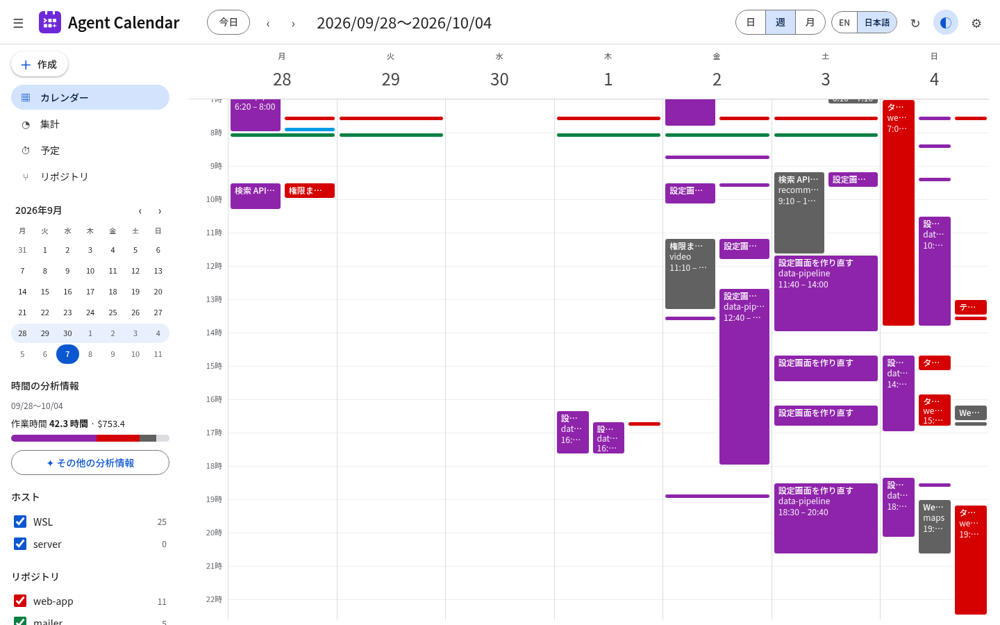
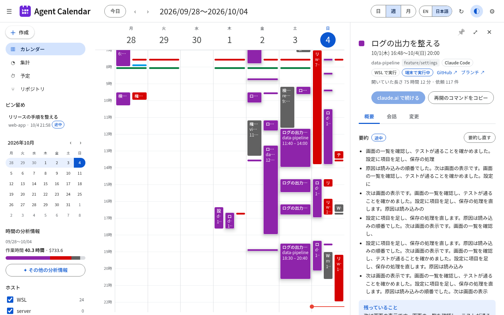
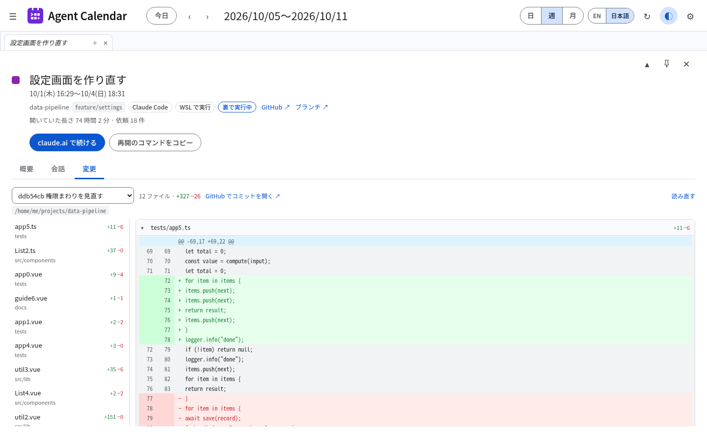
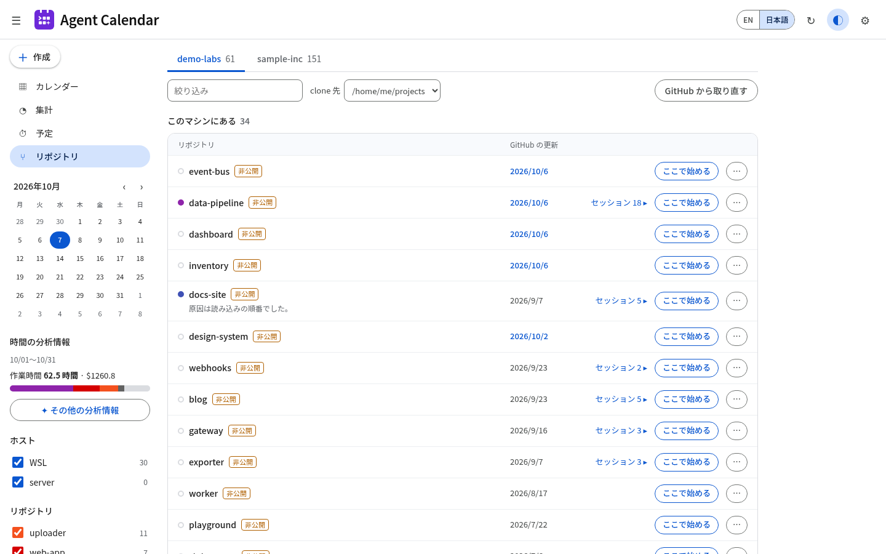
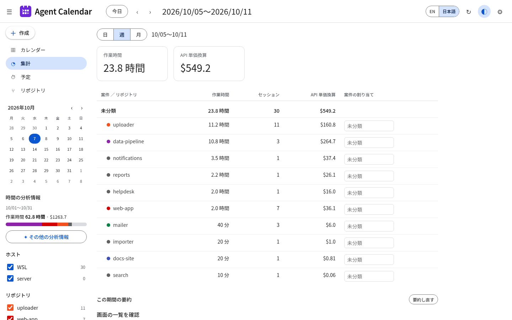
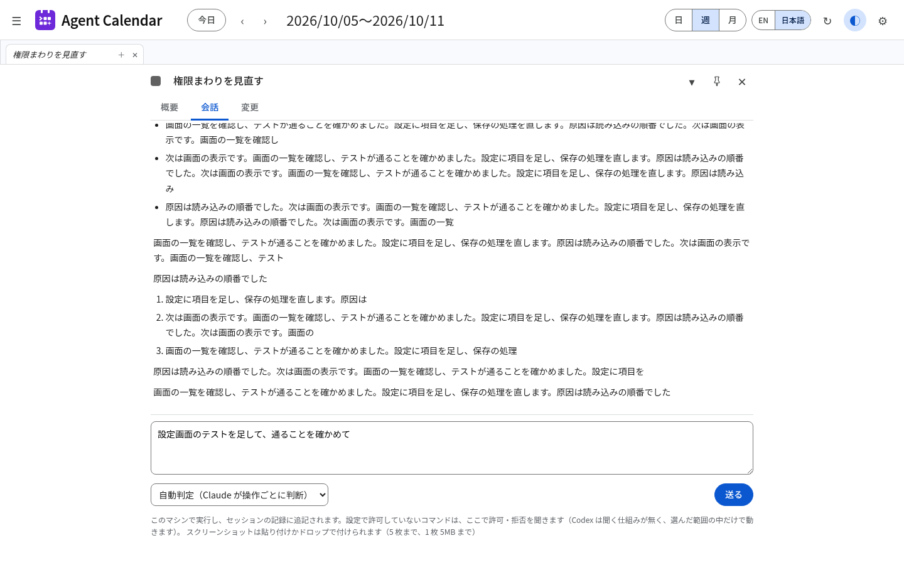
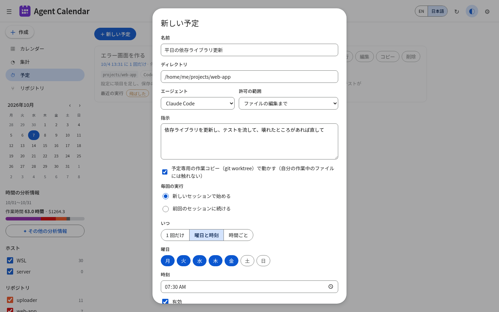
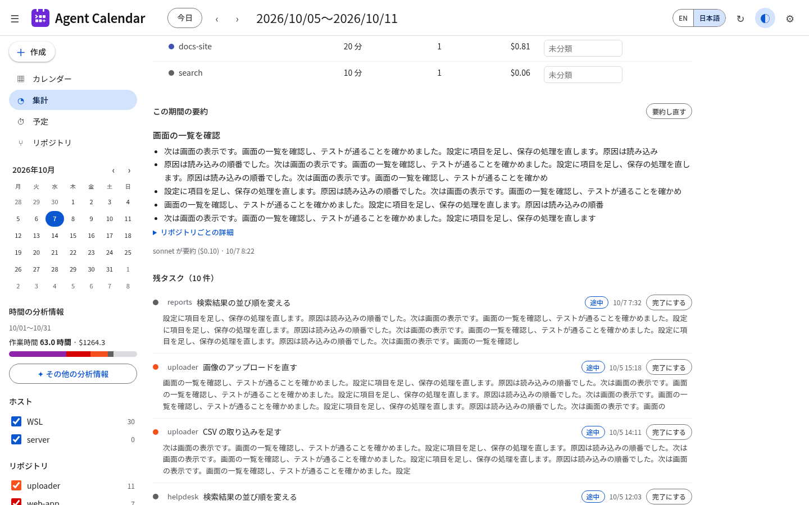

<p align="center"></p>

# agent-calendar

[English](README.md) | [日本語](README.ja.md)

**AI コーディングエージェントのセッションを、手元のカレンダーで見るツール。** [Claude Code](https://docs.claude.com/en/docs/claude-code)
と [Codex CLI](https://github.com/openai/codex) がホームディレクトリに残しているセッションの記録を読み、
日・週・月のカレンダーで見せます。セッションごとの要約、案件ごとの作業時間と API 単価で換算した費用、会話の履歴、
セッションの続きの指示もできます。決めた時刻にリポジトリでエージェントへ指示を実行させる予定も組めます。

すべて自分のマシンの中で動きます。画面は `127.0.0.1` でだけ出します。



## できること

- **カレンダー**: 日・週・月の表示を Google カレンダー風に。ホストとリポジトリで絞り込める
- **セッションの詳細**: 要約（やったこと、完了／途中／相談のみ、残っていること）、本体・サブエージェント・advisor 別の費用、
  セッション中に自分が入れた git のコミット、会話の履歴、GitHub 風の差分で見る変更（画像は変更前と変更後を並べる。まだ commit していない分・コミット 1 つ・`origin/main` などと比べた
  ブランチ全体）。「今すぐ要約」で好きなときに要約でき、
  「完了にする」で完了の印を付けられる。詳細は右のパネルの上にタブで開き、＋で残したタブは並べて切り替えられる。
  パネルの端をドラッグすると幅を変えられる
- **集計**: 案件ごとの作業時間・セッション数・費用を日・週・月で。リポジトリと案件の対応は画面で選ぶ。
  その下に、ボタンで作って保存する期間の要約と、同じ期間の残タスク（要約が途中のものと、完了以外で残っていることが
  書かれているもの）を並べ、開く・完了にする（直後なら取り消せる）ができる。残タスクは期間を問わない一覧にも切り替えられ、
  まだ要約していないセッションも開いて要約・完了にできる。表の下に、モデル別・種類別（本体・サブエージェント・advisor）の
  費用とトークン数、リポジトリごとのセッション、CSV の書き出し。サイドバーで隠したリポジトリは数えない
- **続き**: Claude Code・Codex のセッションに画面から続きの指示を出す（読むだけ／ファイルの編集まで／自動判定を選ぶ）。
  Claude が許可の要るコマンドを使うときは、画面に許可・拒否の確認が出る。動いている指示は「中断」で止められる（エージェントが起動したテストや開発サーバーも止まる。1 回の指示は最長 60 分）。
  worktree が消えたセッションでは、本体のリポジトリで動くと知らせる。書きかけの指示はタブを切り替えても残り、送れなかったときは戻る。
  Claude Code のセッションは Remote Control で裏に再開もできる。`claude --resume` / `codex resume` のコマンドもコピーできる
- **予定**: 決めたディレクトリで Claude Code か Codex に指示を実行させる。1 回だけ・曜日指定・時間帯の中で N 分ごと、
  別の git worktree で動かすことも、モデルを選ぶこともできる。結果はカレンダーに出る。予定ごとに、1 回ごとの費用と所要時間、
  成功・失敗の数つきの全部の実行を見られ、動いている回は止められる。端末で開いているセッションに続ける回は飛ばす
- **リポジトリ**: 組織を選ぶと、その組織の GitHub のリポジトリと手元の clone（設定したフォルダの直下を `origin` で突き合わせ）、
  最後に作業した日、GitHub の最終更新日が並ぶ。扱う組織は設定で選んだものだけ。手元にあればそこで Claude Code か Codex の
  新しいセッションを始められ（モデルを選び、`origin/main` などから切った新しい worktree か、すでにある worktree で作業する）、
  無ければ clone できる。リポジトリごとの ⋯ のメニューから、GitHub からの fetch と、終わった worktree・ローカルのブランチの
  削除ができる（worktree ごとに、まだ commit していない変更の数・取り込み済みか・最後のセッションを出す）。手元の clone には
  いまのブランチを添え、GitHub に届かないときは前の一覧を注記つきで出す。`gh` のログインを使う
- **利用枠**: 各エージェントの 5 時間・週・モデルごとの枠の使い具合と、戻る時刻。外へは問い合わせず、手元の記録だけを使う
  （Codex はセッションの記録、Claude Code と Antigravity（Gemini）は statusline に渡される値。`agent-calendar statusline` を
  statusline のコマンドに登録する。Antigravity と Muse は上限に当たったときの記録）。どの値もいつの時点かを添える
- **実行中**: 画面から送った指示・「ここで始める」・予定のうち、いま動いている数と、許可の答えを待っている数をヘッダーに出す
  （許可待ちはブラウザのタブの題にも）。一覧には、エージェントの返答で止まって次の指示を待っているセッションも並ぶ。
  動いているセッションはカレンダー・タブ・ピン留めにも印が付く
- **裏の処理**: 記録の読み直し・要約・別のマシンの取り込みが最後にうまくいった時刻と、失敗していればその理由を設定に出す。
  失敗があればヘッダーに印が出る
- **ピン留め**: 進めている会話をピン留めすると、サイドバーの上に並ぶ
- **検索**（ヘッダーの検索欄か `/`）: リポジトリ・ブランチ・worktree のフォルダ・題・要約・依頼とエージェントの返答の文章から、
  このマシンの過去のセッションを探す（空白で区切った語をすべて含むもの）。Claude / Codex と期間で絞れ、↑↓ と Enter で選べ、
  続きも読める。押すと会話が開き、そこから続きの指示を送ると、そのセッションの作業場所で動く。
  worktree を消したセッションは印が付く（続きはリポジトリの本体で動くため）
- **新しいセッションで始める**（セッションの詳細）: 同じ作業場所（リポジトリの本体か worktree）・そこに出ているブランチで、前の会話を持ち越さない
  新しいセッションを始め、その会話を開く。ダイアログに作業場所とブランチを出し、記録のブランチと違えば知らせる。作業場所が消えていれば始めない。
  このマシンでセッションが動いたフォルダなら、設定で選んだ組織のリポジトリでなくても始められる
- **スクリーンショット**: 指示に画像を貼り付け・ドロップで付けられる（PNG・JPEG・GIF・WebP、5 枚まで、1 枚 5MB まで）
- **別のマシン**: `share` / `remote add` で、別のマシンのセッションを HTTPS（証明書の固定と合言葉）で取り込む
- **スクショ用の表示**（ヘッダーの ◐）: リポジトリ名・題・会話・パス・差分をそれらしい作り物に置き換える。時間・件数・費用は本物のまま。
  SNS や README に載せる画面を撮るため。オンのあいだは保存や送信はできない
- 画面は英語と日本語

### 画面

| セッションの詳細 | 変更 |
|---|---|
|  |  |
| **リポジトリ** | **集計** |
|  |  |
| **会話** | **予定** |
|  |  |
| **残タスク** | |
|  | |

画面はスクショ用の表示で撮っているので、名前や文章は作り物です。

## インストール

Linux（WSL2 を含む）と macOS:

```sh
curl -fsSL https://raw.githubusercontent.com/uiuifree/agent-calendar/main/install.sh | sh
```

`~/.local/bin` に `agent-calendar` が入ります。systemd のある Linux なら続けて:

```sh
agent-calendar service install     # systemd のユーザーサービスとして常駐させる
```

それ以外は:

```sh
agent-calendar serve
```

を動かして <http://127.0.0.1:23848/> を開きます。

### 更新

1 日 1 回 GitHub Releases を確かめ、新しい版があればヘッダーに **vX.Y.Z に更新できます** と出します。
押すと、このマシン向けの配布物を取り、公開されている sha256 で確かめてから本体を入れ替え、（systemd の下なら）再起動します。
エージェントが動いているあいだは入れ替えません。設定で自動の入れ替えをオンにすることも、`agent-calendar update`
（`--check` で確かめるだけ）で入れることもできます。ソースからビルドしたもの（cargo の `target/` の下と、`cargo install` で
`~/.cargo/bin` に入れたもの）は入れ替えません。要約を作っている最中でも入れ替えます（その要約はあとで作り直します）。

### ソースから

```sh
git clone https://github.com/uiuifree/agent-calendar && cd agent-calendar
(cd web && npm ci && npm run build)   # 画面はバイナリに埋め込む
cargo install --path .
```

## 使い方

```text
agent-calendar serve [--port 23848] [--no-summarize] [--summary-model sonnet] [--summary-lang en|ja]
agent-calendar scan
agent-calendar summarize [--limit 20] [--model sonnet] [--lang en|ja]
agent-calendar todo [--from 2026-10-06] [--to 2026-10-07] [--all] [--repo <path>]
agent-calendar done <session id> [--undo]
agent-calendar stats [--from …] [--to …] [--json | --csv]
agent-calendar report [--from …] [--to …]
agent-calendar search <語…> [--json]
agent-calendar limits
agent-calendar statusline --agent claude|gemini
agent-calendar service install [--port 23848] [--no-summarize] [--summary-lang en|ja] [--force]
```

`todo` は、その日々（指定しなければ今日）に動いたセッションのうち、要約で途中になっているものと、完了以外で残っていることが
書かれているものを 1 行ずつ出します（id・最後に動いた時刻・状態・リポジトリ・題・残っていること）。`done` で完了の印を
付けると一覧から消え、画面でも完了として出ます。そのセッションをあとで続けたら印は外れます。画面ではセッションの
概要の「完了にする」から付けられます。`stats` は案件・リポジトリごとの作業時間・セッション数・費用（`--csv` で表計算向け）、
`report` は同じ期間の集計・残タスク・保存した期間の要約を Markdown で、`search` は過去のセッションの検索、`limits` は各エージェントの
利用枠を出します。

Claude Code と Antigravity の利用枠を出すには、Claude Code の statusline に `agent-calendar statusline --agent claude` を登録します
（`~/.claude/settings.json` に `"statusLine": {"type": "command", "command": "agent-calendar statusline --agent claude"}`）。
Antigravity は `--agent gemini` を `~/.gemini/antigravity-cli/settings.json` に。受け取った利用枠を画面のために残し、statusline には
`5h 23% · 7d 41%` のように出します。

`service install` は、画面から始めたエージェントがサービスの中でまだ動いていれば、起こし直しません。`--force` を付けると
それでも起こし直します。

`serve` は 5 分ごとに記録を読み直し、止まったセッションを 1 時間ごとに 1 回 10 件まで要約します（7〜22 時）。
時間帯と間隔は画面の設定で変えられます。
要約の言語は、`$LANG` が `ja` で始まれば日本語、そうでなければ英語です。

## しくみ

| 記録 | 読む場所 | 補足 |
|---|---|---|
| Claude Code | `~/.claude/projects/*/*.jsonl` | サブエージェントの記録（`<session>/subagents/`）は親のトークン・費用に足す |
| Codex CLI | `~/.codex/sessions/**/rollout-*.jsonl` | トークン数のみ（金額は出さない）。サブエージェントのスレッドは数えない |

- 集計は `~/.local/share/agent-calendar/agent-calendar.db`（SQLite）に置きます。Claude Code は古い記録を消します（設定の
  `cleanupPeriodDays`）が、一度集計したセッションはカレンダーに残ります
- 作業ディレクトリは git のリポジトリ単位にまとめます（worktree は本体のリポジトリに寄せる）
- **要約**は、自分の Claude Code のログインで `claude -p --no-session-persistence` を呼んで作ります。Claude のプランの使用量を使います。
  送るのは依頼とエージェントの文章だけで、ツールの入出力は送りません。`--no-summarize` で止められ、設定でリポジトリごとにも止められます。
  要約に失敗したセッションは、記録が変わらないうちは間を空けて 3 回まで試し、理由を詳細に出します
- **費用**は Anthropic API の単価（`src/pricing.rs`、2026-09-25 時点）で換算した目安で、サブスクの請求額ではありません。
  advisor とサブエージェントの分を含みます。単価の分からないモデルを含むときは `+` を付けます
- **作業時間**は、セッションをまたいで 10 分の枠を合わせて数え、30 分以内の中断はつなげます。エージェントが動いていた時間で、
  実際の作業時間とは一致しません
- **再開**は、一度裏に出したセッションには `claude respawn`、それ以外は `claude --bg --resume <id> --remote-control` を使います。
  Linux では `systemd-run --user --scope` の中で起動するので、サービスを再起動しても再開したセッションは止まりません

## セキュリティとプライバシー

- サーバーは `127.0.0.1` で待ち受け、`Host` が `127.0.0.1|localhost|[::1]:<port>` のものだけ受けます（DNS rebinding を防ぐ）。
  書き込みと再開は JSON の本文を必須にし、別のオリジンからのリクエストは断ります
- 記録には打った内容がそのまま入っています。Agent Calendar が記録を送るのは、`claude -p` を通した要約の依頼、画面や予定から送る指示
  （自分の `claude` / `codex` が動く）、`share` で組んだマシンへの記録の受け渡しだけです。ほかに 1 日 1 回 GitHub Releases を確かめ
  （設定で止められる）、リポジトリの画面で `gh` を使います。エージェントの返答の中の画像は読み込まず、リンクとして出します

## 対応状況

agent-calendar は、安定した API として公開されていない記録の形と CLI のコマンド（`~/.claude/projects`、`claude agents --json`、
`claude respawn`、`~/.codex/sessions`）に依存しています。**Claude Code 2.1.292** と **Codex CLI 0.154.0** の Linux（WSL2）で
確かめています。macOS 版はまだ確かめていません。新しい版で動かなくなったら、版番号を添えて issue を立ててください。

## よくある質問

### 先週 Claude Code で何をしたか見るには？

週表示を開き、矢印（または `k`）で 1 週戻ります。セッションごとに、止まったあとで書いた要約が付いています。

### Claude Code や Codex の作業時間を案件ごとに出すには？

集計を開き、リポジトリごとに案件を一度選べば、週・月で切り替えて見られます。

### Claude Code の使用量を API の単価に直すといくら？

集計と各セッションの詳細に、本体・サブエージェント・advisor 別の API 単価換算を出しています。

### スマホから Claude Code のセッションを再開できる？

できます。セッションの「Remote Control で再開」を押すと、手元のマシンの裏で起動し、Claude アプリの Code の一覧に出ます。
ボタン自体は手元の画面にあるので、押すのはそのマシンからです。

### 記録をどこかに送っている？

要約のときだけ、自分の `claude -p` を通して送ります（ほかは「セキュリティとプライバシー」）。`--no-summarize` で止められ、
設定でリポジトリごとにも止められます。

### Windows で使える？

Claude Code を WSL2 で使っているなら、WSL2 の中で使えます。Windows ネイティブには対応していません。

## まだ対応していないこと

- Codex（OpenAI）のモデルの金額、Codex のサブエージェントのスレッド、Codex のセッションの Remote Control での再開
- ダークモード

## ライセンス

次のどちらかを選べます。

- Apache License, Version 2.0（[LICENSE-APACHE](LICENSE-APACHE)、<https://www.apache.org/licenses/LICENSE-2.0>）
- MIT license（[LICENSE-MIT](LICENSE-MIT)、<https://opensource.org/licenses/MIT>）

### コントリビューション

特に断りがない限り、このプロジェクトに取り込まれることを意図して提出されたコントリビューションは、
Apache-2.0 の定義に従い、追加の条件なしに上記のデュアルライセンスで提供されるものとします。

---

agent-calendar は Anthropic・OpenAI・Google とは関係がなく、承認も受けていません。Claude と Claude Code は Anthropic, PBC の、
Codex は OpenAI の、Google カレンダーは Google LLC の商標です。
