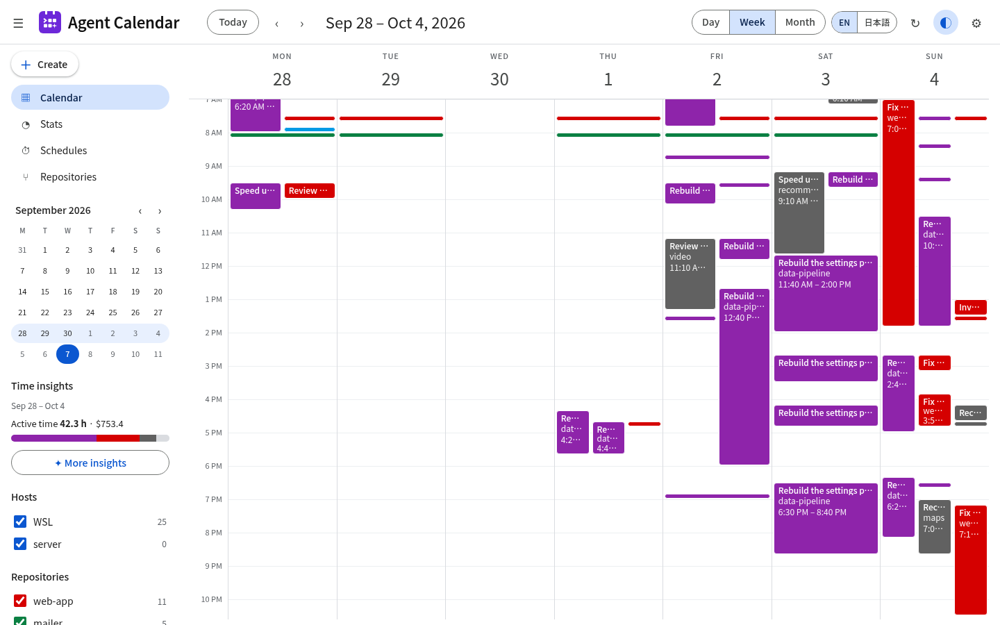
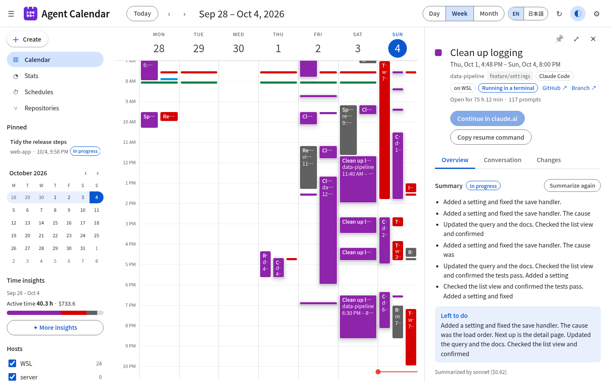
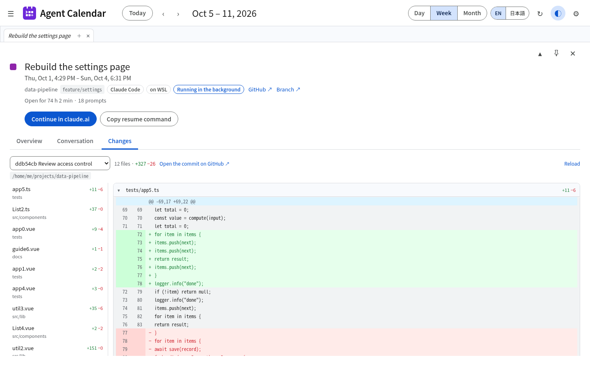
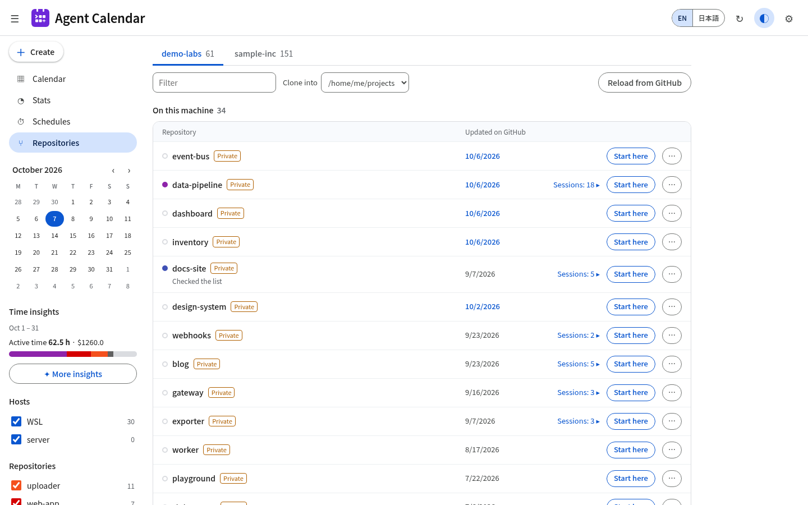
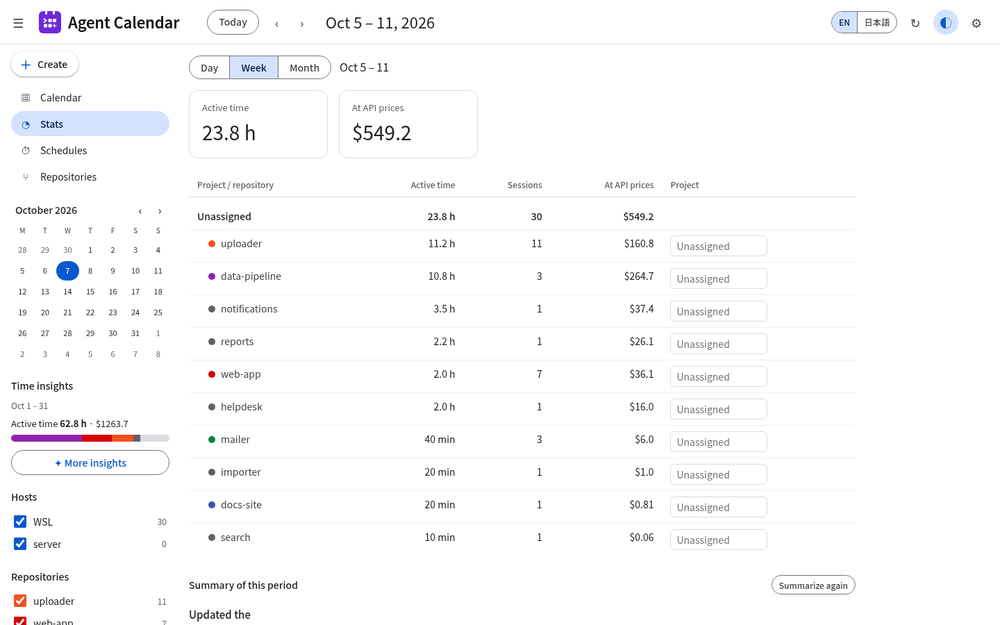
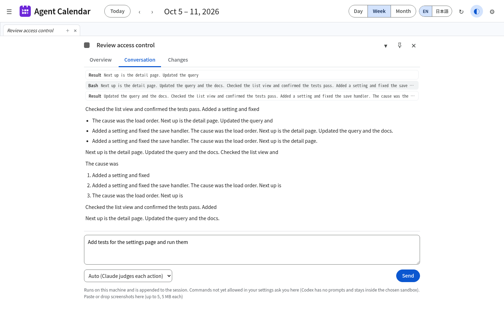
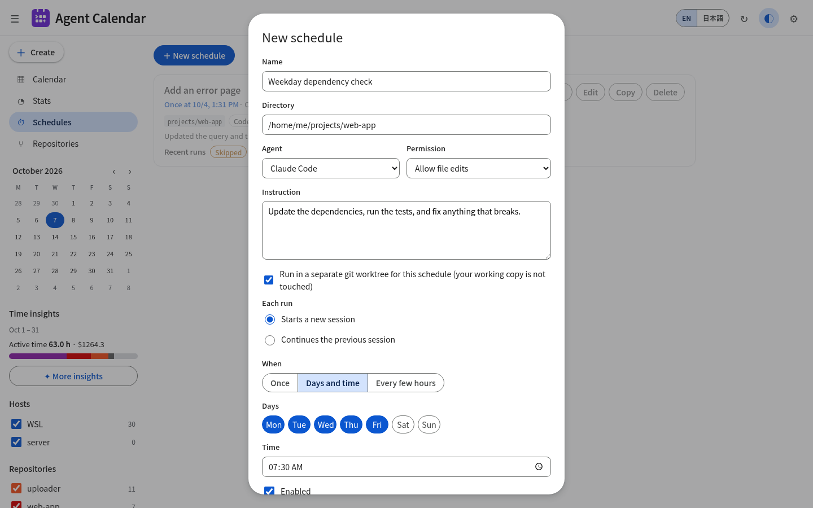
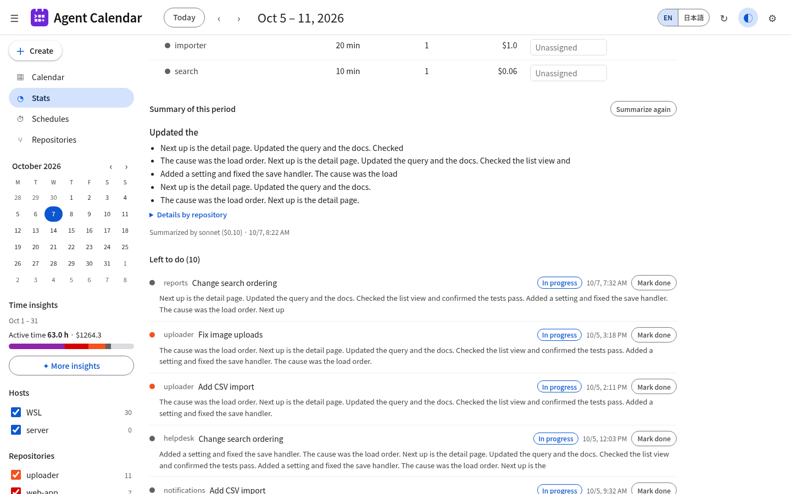

<p align="center"></p>

# agent-calendar

[English](README.md) | [日本語](README.ja.md)

**A local calendar for your AI coding agent sessions.** agent-calendar reads the session transcripts that
[Claude Code](https://docs.claude.com/en/docs/claude-code) and [Codex CLI](https://github.com/openai/codex)
already write to your home directory, and shows them on a day / week / month calendar, with an AI-written
summary of each session, active time and an API-price cost estimate per project, the conversation history,
and ways to continue a session. You can also schedule an agent to run a prompt in a repository at set times.

Everything runs on your machine. The page is served on `127.0.0.1` only.



## What you get

- **Calendar** – day, week and month views in a Google Calendar–style layout. Filter by host and repository.
- **Session details** – summary (what was done, done / in progress / discussion, what is left), cost split into
  agent / subagents / advisor, your git commits made during the session, the conversation history, and the changes
  as a GitHub-style diff (images before and after, side by side) for uncommitted work, one commit, or the whole branch
  against `origin/main` or another base. Summarize a session on demand with *Summarize now*, or mark it done with *Mark done*.
  Details open in tabs at the top of the right panel: keep a tab with ＋ to have several sessions side by side, and drag
  the panel's edge to make it wider.
- **Stats** – active time, session count and cost per project for a day, week or month. You assign repositories
  to projects in the page. Below it, a summary of the period that you write with a button and that is kept, and
  what is left to do in that period: sessions in progress, or not done with something left in their summary, which you
  can open or mark done (or undo right after). Switch the list to any time to see work left from earlier weeks, and open
  the sessions that are not summarized yet to summarize or mark them. Below the table: cost and tokens per model and per
  kind (agent / subagents / advisor), each repository's sessions, and *Download CSV*. Repositories hidden in the sidebar are
  left out of the numbers.
- **Continue** – send the next instruction to a Claude Code or Codex session from the page (read-only, allowed
  to edit, or Claude's auto mode). When Claude needs approval for a command, the page asks you to allow or deny it.
  *Stop* stops an instruction that is running, together with the commands the agent started (tests, dev servers); an
  instruction runs for up to 60 minutes. If the session's worktree has been removed, the page tells you it will run in the
  main repository. What you are writing is kept when you switch tabs, and comes back if sending fails. You can also resume a Claude Code session in the background with Remote Control, or copy the
  `claude --resume` / `codex resume` command.
- **Schedules** – run a prompt with Claude Code or Codex in a chosen directory once, on chosen weekdays, or every
  N minutes within a time window, optionally in a separate git worktree and with a chosen model. Results show up on the
  calendar. Each schedule has its full history with the cost and duration of each run and the success and failure counts,
  and a running one can be stopped. A run that would continue a session open in a terminal is skipped.
- **Repositories** – pick a GitHub organization (only the ones you list in Settings) and see its repositories next to
  your local clones (matched by `origin` in the folders you list), when you last worked in each, and when it was last
  updated on GitHub. Start a new Claude Code or Codex session in a clone (choose the model, and work in a new worktree
  cut from `origin/main` or another branch, or in a worktree that already exists), or clone a missing one. The ⋯ menu
  of each repository fetches from GitHub and removes finished worktrees and local branches, showing for each worktree its
  uncommitted changes, whether its branch is merged, and the last session there. Local clones show their current branch, and
  if GitHub cannot be reached the last list is shown with a note. Uses your `gh` login.
- **Usage limits** – each agent's 5-hour, weekly and per-model limits and when they reset, from local records only:
  Codex from its transcripts, Claude Code and Antigravity (Gemini) from what their status line receives (add
  `agent-calendar statusline` as the status line command), and Antigravity and Muse from the times they hit a limit.
  Each value shows when it was recorded.
- **Running now** – the header shows how many instructions, new sessions and schedules started from the page are running,
  and how many are waiting for your approval (also in the browser tab title). The list also shows sessions that ended with
  the agent's reply and are waiting for your next instruction. Running sessions are marked on the calendar and in tabs and pins.
- **Background jobs** – Settings shows when rescans, summaries and collecting from other machines last worked, and why
  they failed if they did; a mark in the header tells you when something failed.
- **Pins** – pin the conversations you are working on; they stay at the top of the sidebar.
- **Search** (the box in the header, or `/`) – find past sessions on this machine by repository, branch, worktree folder, or words from
  the title, summary, your instructions or the agent's replies (all words must match). Narrow it to Claude or Codex and a period,
  move with ↑ ↓ and Enter, and load more results. Pick one to open its conversation; an instruction sent from there runs
  where the session ran. Sessions whose worktree has been removed are marked, since continuing them runs in the main repository.
- **New session here** (session details) – start a fresh session, without the earlier conversation, in the same folder (main repository
  or worktree) on the branch checked out there, and open its conversation. The dialog shows the folder and branch and tells you if the
  branch differs from the one the session recorded. It does not start if the folder is gone. It works for any folder a session ran in on
  this machine, not only repositories of the GitHub owners in settings.
- **Screenshots** – paste or drop images (PNG, JPEG, GIF, WebP; up to 5, 5 MB each) into an instruction.
- **Other machines** – collect sessions from another machine over HTTPS (pinned certificate and token) with
  `share` / `remote add`.
- **Screenshot mode** (◐ in the header) – replaces repository names, titles, conversations, paths and diffs with
  sample content while keeping times, counts and costs real, so you can share screenshots. Editing is disabled while it is on.
- English and Japanese UI.

### Screenshots

| Session details | Changes |
|---|---|
|  |  |
| **Repositories** | **Stats** |
|  |  |
| **Conversation** | **Schedules** |
|  |  |
| **Left to do** | |
|  | |

The screenshots are taken in screenshot mode, so names and text are sample content.

## Install

Linux (including WSL2) and macOS:

```sh
curl -fsSL https://raw.githubusercontent.com/uiuifree/agent-calendar/main/install.sh | sh
```

This puts `agent-calendar` in `~/.local/bin`. Then, on Linux with systemd:

```sh
agent-calendar service install     # starts a systemd user service
```

or anywhere:

```sh
agent-calendar serve
```

and open <http://127.0.0.1:23848/>.

### Updates

Agent Calendar checks GitHub Releases once a day and shows **Update to vX.Y.Z** in the header when a new version is out.
Clicking it downloads the release for your machine, verifies it against the published sha256, replaces the binary and
restarts the service (when it runs under systemd). Updates never start while an agent is running. You can also turn on
automatic updates in Settings, or run `agent-calendar update` (`--check` to only look). Builds from source (under cargo's
`target/` or installed with `cargo install` into `~/.cargo/bin`) are not replaced. An update can start while a summary is
being written; that summary is written again later.

### From source

```sh
git clone https://github.com/uiuifree/agent-calendar && cd agent-calendar
(cd web && npm ci && npm run build)   # the web UI is embedded into the binary
cargo install --path .
```

## Usage

```text
agent-calendar serve [--port 23848] [--no-summarize] [--summary-model sonnet] [--summary-lang en|ja]
agent-calendar scan
agent-calendar summarize [--limit 20] [--model sonnet] [--lang en|ja]
agent-calendar todo [--from 2026-10-06] [--to 2026-10-07] [--all] [--repo <path>]
agent-calendar done <session id> [--undo]
agent-calendar stats [--from …] [--to …] [--json | --csv]
agent-calendar report [--from …] [--to …]
agent-calendar search <words…> [--json]
agent-calendar limits
agent-calendar statusline --agent claude|gemini
agent-calendar service install [--port 23848] [--no-summarize] [--summary-lang en|ja] [--force]
```

`todo` lists the sessions of those days (default: today) that are in progress, or not done with something left to do in
their summary, one per line: id, last activity, status, repository, title, what is left. `done` marks a session as done; it
then leaves the list and shows as done in the page until the session continues. You can also do this from the page
(Mark done in a session's Overview). `stats` prints active time, sessions and cost per project and repository (`--csv` for a
spreadsheet), `report` prints the same period as Markdown with what is left and the saved period summary, `search` finds past
sessions, and `limits` prints each agent's usage limits.

To see Claude Code's and Antigravity's limits, set `agent-calendar statusline --agent claude` as Claude Code's status line
(`"statusLine": {"type": "command", "command": "agent-calendar statusline --agent claude"}` in `~/.claude/settings.json`) and
`--agent gemini` for Antigravity (`~/.gemini/antigravity-cli/settings.json`). It keeps the limits it receives for the page and
prints them as the status line (for example `5h 23% · 7d 41%`).

`service install` does not restart the service while agents started from the page are still running in it; add `--force` to
restart anyway.

`serve` rescans every 5 minutes and summarizes idle sessions every hour (10 per round) between 7:00 and 22:00;
change the hours and intervals from the settings in the page. The summary language defaults to Japanese when `$LANG` starts with `ja`, English otherwise.

## How it works

| Source | Where it reads | Notes |
|---|---|---|
| Claude Code | `~/.claude/projects/*/*.jsonl` | Subagent transcripts (`<session>/subagents/`) count toward the parent's tokens and cost |
| Codex CLI | `~/.codex/sessions/**/rollout-*.jsonl` | Token counts only (no prices); subagent threads are skipped |

- The index lives in `~/.local/share/agent-calendar/agent-calendar.db` (SQLite). Claude Code cleans up old transcripts
  (see its `cleanupPeriodDays` setting); sessions already indexed stay on the calendar.
- Working directories are grouped by git repository, so worktrees count as their main repository.
- **Summaries** are written by `claude -p --no-session-persistence` using your own Claude Code login, so they
  use your Claude plan. Only your prompts and the agent's text replies are sent (no tool input or output).
  Turn them off with `--no-summarize`, or for some repositories only in Settings. A session that fails to summarize
  is tried again later, up to 3 times while it does not change, and the reason shows in its details.
- **Cost** is an estimate at Anthropic API list prices (see `src/pricing.rs`, prices as of 2026-09-25), not your
  subscription bill. It includes advisor calls and subagents. Models without a known price are shown as `+`.
- **Active time** merges 10-minute buckets across sessions; a pause of up to 30 minutes counts as continuous.
  It is the time an agent was running, not your working time.
- **Resume** uses `claude respawn` for sessions that were backgrounded before, and
  `claude --bg --resume <id> --remote-control` otherwise. On Linux it runs inside a `systemd-run --user --scope`
  so restarting the service does not stop the resumed session.

## Security and privacy

- The server binds to `127.0.0.1` and accepts only `Host: 127.0.0.1|localhost|[::1]:<port>`, which blocks DNS
  rebinding. Writes and resume require a JSON body and refuse requests from other origins.
- Transcripts can contain anything you typed. Agent Calendar itself sends them nowhere except: summary requests to
  Anthropic through `claude -p`; instructions you send from the page or schedules, which run your own `claude` / `codex`;
  and transcripts served by `share` to the machines you paired. It also checks GitHub Releases once a day (turn this off
  in Settings) and uses `gh` for the Repositories page. Images in agent replies are shown as links and are not loaded.

## Compatibility

agent-calendar depends on transcript formats and CLI commands that are not documented as stable APIs
(`~/.claude/projects`, `claude agents --json`, `claude respawn`, `~/.codex/sessions`). Tested with
**Claude Code 2.1.292** and **Codex CLI 0.154.0** on Linux (WSL2). The macOS build is not tested yet.
If a newer version breaks something, please open an issue with the version numbers.

## FAQ

### How do I see what I did with Claude Code last week?

Open the week view and step back a week with the arrow (or press `k`). Each session has a summary written after it went idle.

### How do I track time spent per project with Claude Code or Codex?

Use the Stats view, assign each repository to a project once, and switch between week and month.

### How much would my Claude Code usage cost at API prices?

The Stats view and each session's details show an API-price estimate, split into agent, subagents and advisor.

### Can I resume a Claude Code session from my phone?

Yes. Press "Resume with Remote Control" on the session; it starts in the background on your machine and appears
in the Code list of the Claude app. The button itself is on the local page, so press it from that machine.

### Does it send my transcripts anywhere?

Only for summaries, and only through your own `claude -p` (see Security and privacy for the rest). Use `--no-summarize`, or
skip summaries for some repositories in Settings.

### Does it work on Windows?

Use it inside WSL2 if you run Claude Code there. Native Windows is not supported.

## Not supported yet

- Prices for Codex (OpenAI) models, Codex subagent threads, Remote Control resume for Codex sessions
- Dark mode

## License

Licensed under either of

- Apache License, Version 2.0 ([LICENSE-APACHE](LICENSE-APACHE) or
  <https://www.apache.org/licenses/LICENSE-2.0>)
- MIT license ([LICENSE-MIT](LICENSE-MIT) or
  <https://opensource.org/licenses/MIT>)

at your option.

### Contribution

Unless you explicitly state otherwise, any contribution intentionally submitted
for inclusion in the work by you, as defined in the Apache-2.0 license, shall
be dual licensed as above, without any additional terms or conditions.

---

agent-calendar is not affiliated with or endorsed by Anthropic, OpenAI or Google. Claude and Claude Code are
trademarks of Anthropic, PBC; Codex is a trademark of OpenAI; Google Calendar is a trademark of Google LLC.
